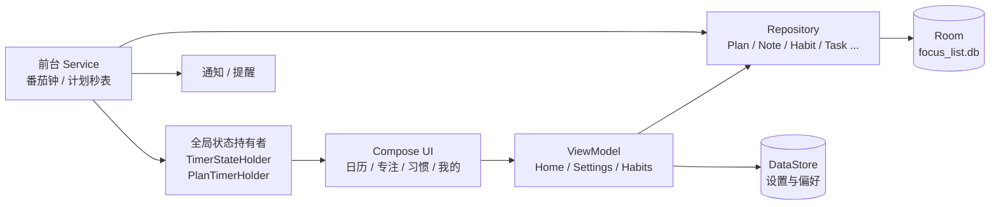

<p align="center">
  
</p>

<p align="center">
  
  
  
  
</p>

一个**纯离线**的 Android 时间管理应用：以日历为入口安排跨日期计划，用秒表记录每天的实际投入，再配合番茄钟、当日备注与习惯打卡，把「计划 → 执行 → 复盘」串成一条线。所有数据只保存在本机，不联网、不上传。

---

## 界面预览

<table>
  <tr>
    <td align="center"><br><sub>日历首页：格子内直接看到进度</sub></td>
    <td align="center"><br><sub>专注页：唱片式光环 + 番茄钟</sub></td>
    <td align="center"><br><sub>当日计划卡与备注</sub></td>
    <td align="center"><br><sub>备注详情：Markdown + 附件</sub></td>
  </tr>
</table>

> 以上为示意图（由 `docs/images/gen_mockups.py` 生成），实际界面以应用为准。

---

## 功能一览

### 📅 日历（首页）

- **月视图**直接铺满屏幕，每个日期格里最多显示 3 条计划：每条是一根迷你进度条，越接近当日目标颜色越深，行尾显示完成率数值（不带百分号）；
- **左右滑动翻页**，跟手移动 + 惯性吸附，一次滑动最多翻一月；顶栏箭头同样带动画；
- **点某一天**收起日历，进入当日计划卡片页：渐变方卡、右上角开始/暂停秒表、长按弹菜单（补录时长 / 删除）、「管理」进入多选批量删除；
- **按日期范围删除**：只移除所选区间内的部分，范围外日期自动保留（覆盖中间时计划会被拆成前后两段）；
- 日历格子高度自适应屏幕，底部自动避开系统导航条与悬浮 Dock。

### ⏱ 计划与秒表

- 计划是**跨日期区间的实体**（起始日 ~ 截止日 + 每日目标时长），不是单日任务；
- 支持**多个计划并行计时**，暂停只冻结不清零，再点继续接着累加；
- 计时基于 wall clock 换算，息屏、切后台、退进程都不影响真实秒数；
- 运行时前台服务常驻**系统计时器样式通知**（状态栏计时胶囊），退后台兜底落库；
- 到达每日目标时可按设置响铃/震动提醒。

### 🍅 番茄专注

- 专注 / 短休息 / 长休息时长与长休息间隔，用 `− 值 +` 步进器调整，配置放在专注页本身（齿轮入口），不散落在设置页；
- **唱片式光环**：42 圈长短交错的同心弧缓慢自转（26s/圈），叠加反向扫光与 7 秒呼吸缩放，休息阶段自动切冷色调；
- **白噪音三种模式**各有不同画面：静音是柔光呼吸，白噪是冷蓝光场 + 漂浮光尘，棕噪是暖琥珀 + 底部声浪；
- **5 种提示音**（清脆铃 / 木鱼 / 水滴 / 颂钵 / 柔音）可点选试听，番茄与计划提醒共用所选音色；
- 自动化开关：番茄结束自动休息、休息结束自动下一番茄、严格模式；
- **防烧屏**：计时中内容以极小幅度极缓慢漂移（暂停即冻结、继续从冻结点续跑），Dock 导航栏 5 秒后自动隐藏、触摸任意位置临时唤出。

### 📝 备注

- 每条备注可设**标题**与**关联日期**（默认当前查看的那天），也可不关联日期作为随手记；
- 正文支持 **Markdown**：标题、加粗、斜体、列表、引用、链接、在线图片；
- 支持**关联本地图片 / 视频**（系统选择器 + 持久读权限），详情页可直接预览或用系统应用打开；
- 当日计划页底部按日期展示备注，**默认最多 3 条**，超出可展开，内容过长省略显示，点击查看详情。

### ✅ 习惯与小组件

- 习惯打卡、连续天数统计；
- 四款**桌面小组件**：任务列表、番茄计时、统计概览、习惯打卡。

---

## 技术栈

| 领域 | 选型 |
| --- | --- |
| 语言 / UI | Kotlin + Jetpack Compose（Material 3，玻璃拟态风格） |
| 数据库 | Room 2.6（本地 SQLite） |
| 偏好存储 | DataStore Preferences |
| 导航 | Navigation Compose，单 Activity + 底部 Dock |
| 异步 | Kotlin Coroutines + StateFlow |
| 后台 | 两个前台 Service（番茄钟 / 计划秒表）+ AlarmManager 提醒 |
| 构建 | Gradle Kotlin DSL + KSP，compileSdk 34 / minSdk 26 / JDK 17 |

## 架构



- **手动依赖注入**：`AppContainer` 按需 lazily 提供数据库、各仓库与设置存储；
- **全局计时状态**用单例 Holder（`StateFlow`）承载，界面与桌面小组件都从同一处读，服务在后台跑时 UI 实时刷新；
- **数据库版本**：v1 任务/习惯 → v2 标签与软删除 → v3 计划与备注 → v4 备注标题/日期与附件表，升级走手写 `Migration` 保留旧数据。

## 目录结构

```text
app/src/main/java/com/focuslist/app/
├── MainActivity.kt          # 单 Activity，Dock 导航 + 路由 + Dock 自动隐藏
├── FocusListApp.kt          # 入口：通知渠道、依赖容器、音效预热
├── data/
│   ├── local/               # Room：实体、DAO、数据库与迁移
│   ├── repo/                # 仓库层（计划、备注、习惯、任务…）
│   └── prefs/               # DataStore 设置（时长、音色、主题、白噪音…）
├── timer/                   # 番茄钟状态机与前台服务
├── ui/
│   ├── home/                # 日历主页（月历、翻页、当日卡片、范围删除）
│   ├── focus/               # 专注页、光环动画、氛围背景、白噪音播放
│   ├── note/                # 备注弹层、Markdown 渲染、图片加载、详情弹窗
│   ├── habits/              # 习惯打卡
│   ├── plan/                # 计划弹层、计划秒表服务、计时持有者
│   ├── common/              # 玻璃组件、Dock、FAB、提示音播放、防烧屏
│   ├── settings/            # 我的（主题、提醒、备注入口）
│   └── theme/               # 主题色与配色
├── notify/                  # 通知、闹钟调度、开机恢复
├── widget/                  # 四款桌面小组件
└── util/                    # 日期工具等
```

## 构建与运行

环境要求：**JDK 17** + **Android SDK 34**（无需 Android Studio 也可以命令行打包）。

```bash
# Windows 一键打包（脚本内已写好本机 JDK / SDK 路径）
build.bat

# 或使用 Gradle 直接构建
./gradlew assembleDebug
```

产物位置：`app/build/outputs/apk/debug/app-debug.apk`，安装：

```bash
adb install -r app/build/outputs/apk/debug/app-debug.apk
```

> `assembleDebug` / `assembleRelease` 执行后会自动把 `version.properties` 的 `versionCode` +1（本次打包仍用旧值，下次生效）。

## 数据与隐私

- 全部数据保存在应用私有目录：Room 数据库 `focus_list.db` + DataStore，**不申请网络权限、不发起任何请求**；
- 申请的权限都与功能直接相关：

| 权限 | 用途 |
| --- | --- |
| `POST_NOTIFICATIONS` | 任务到期、计时结束提醒 |
| `SCHEDULE_EXACT_ALARM` | 准点提醒 |
| `RECEIVE_BOOT_COMPLETED` | 重启后恢复提醒 |
| `FOREGROUND_SERVICE(_SPECIAL_USE)` | 番茄钟与计划秒表后台计时 |
| `VIBRATE` | 结束提醒震动 |

## 说明

- 提示音为程序化合成（正弦波 + 包络），不含第三方录音素材；界面预览图为脚本生成的矢量示意图；
- 项目为个人自用工具，暂未开源许可证约定，如需引用请先联系作者。
