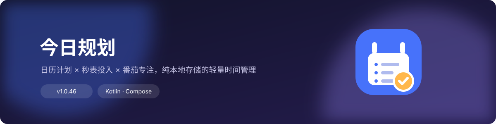
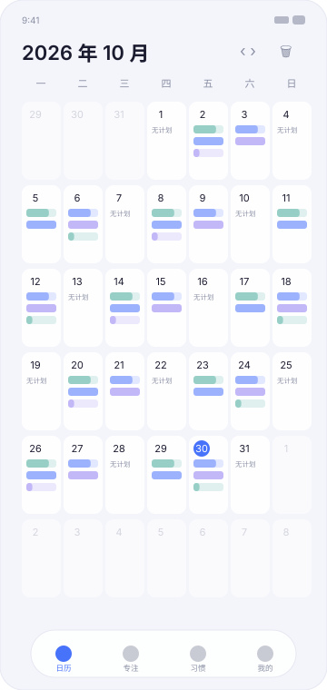
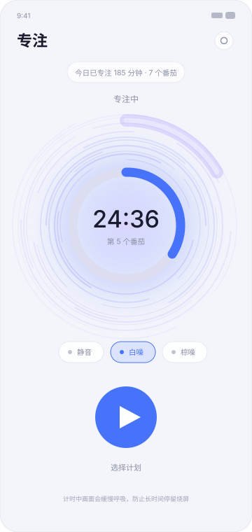
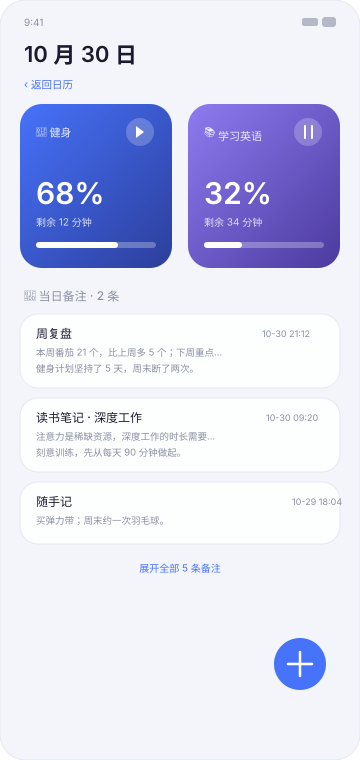
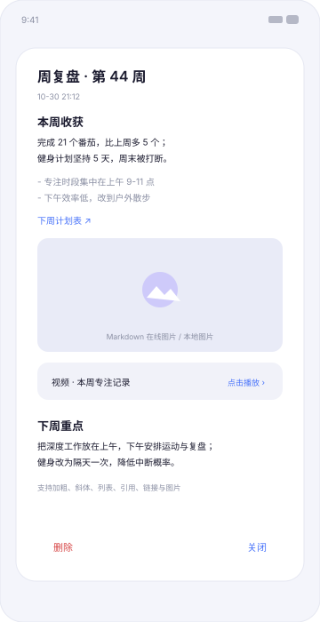
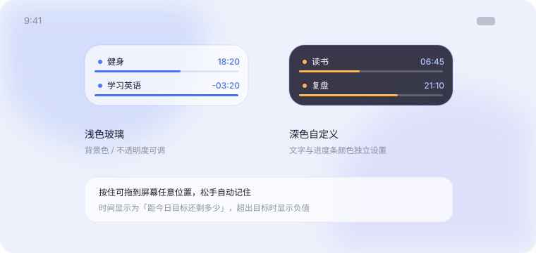
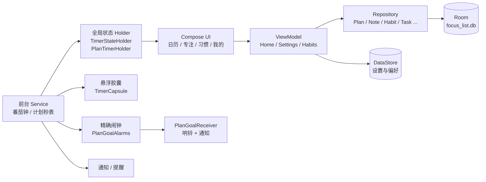

<p align="center">
  
</p>

<p align="center">
  
  
  
  
</p>

**今日规划**是一个纯离线的 Android 时间管理应用：以日历为入口安排跨日期计划，用秒表记录每天的真实投入，再用番茄钟与备注把「规划 → 执行 → 复盘」串起来。所有数据只保存在本机，不联网、不上传。

---

## 界面预览

<table>
  <tr>
    <td align="center"><br><sub>日历首页：格子内直接看到进度</sub></td>
    <td align="center"><br><sub>专注页：唱片式光环 + 番茄钟</sub></td>
    <td align="center"><br><sub>当日计划卡与备注</sub></td>
    <td align="center"><br><sub>备注全屏页：查看 / 编辑</sub></td>
  </tr>
</table>

<p align="center">
  
</p>

> 以上为示意图（由 `docs/images/gen_mockups.py` 生成），实际界面以应用为准。

---

## 项目宣传片

[`video/today-plan-promo.mp4`](video/today-plan-promo.mp4) —— 36 秒、1920×1080 / 25fps、配 **128 BPM 原创电子流行 BGM**（程序合成，无版权素材），可发 B 站 / 视频号。

| 时间 | 内容 |
| --- | --- |
| 0–5s | 开场：图标落位 + 「今日规划 · 把今天，安排明白」 |
| 5–12s | 日历：格子内的进度、滑动翻月、点开某天开始计时 |
| 12–19s | 专注：唱片式光环、三种白噪音、五种提示音 |
| 19–26s | 悬浮胶囊：后台可见、多计划逐行、拖动与配色 |
| 26–32s | 备注：全屏页面、Markdown 与附件 |
| 32–36s | 结尾：Logo + 纯离线说明 |

**重新生成**（全部资源都是代码产出的，可随时改文案重做）：

```bash
python video/make_audio.py          # 合成 36s BGM（128 BPM，底鼓/拍手/贝斯/琶音/Pad）
node video/render.mjs               # 逐帧渲染（Chromium + CDP，输出 .tmp_docs/frames）
ffmpeg -y -framerate 25 -i .tmp_docs/frames/f%05d.jpg -i .tmp_docs/promo.wav \
  -c:v libx264 -preset slow -crf 20 -pix_fmt yuv420p \
  -af "loudnorm=I=-16:TP=-1.5:LRA=11" -c:a aac -b:a 160k \
  -shortest -movflags +faststart video/today-plan-promo.mp4
```

> 动画在 `video/promo.html` 里由 `window.seek(t)` 驱动，时间轴可精确到帧；想改文案、节奏或配色，改这个文件即可。
> BGM 为纯合成音源：抖音热门曲库中的歌曲均有版权，不能直接随片分发；这里用同风格的原创律动替代。


---

## 功能一览

### 📅 日历（首页）

- **月视图**铺满屏幕，每个日期格最多显示 3 条计划：每条是迷你进度条，越接近当日目标颜色越深，行尾显示完成率数值；
- **左右滑动翻页**，跟手移动 + 惯性吸附；顶栏箭头同样带动画；
- **点某一天**进入当日卡片页：渐变方卡、右上角开始/暂停秒表、长按菜单（补录时长 / 删除）、「管理」多选批量删除；
- **按日期范围删除**：只移除区间内的部分，范围外日期自动保留（覆盖中间时计划会被拆成前后两段）；
- 格子高度自适应屏幕，底部自动避开系统导航条与悬浮 Dock。

### ⏱ 计划与秒表

- 计划是**跨日期区间的实体**（起始日 ~ 截止日 + 每日目标时长），不是单日任务；
- 支持**多个计划并行计时**，暂停只冻结不清零，再点继续接着累加；
- 基于 wall clock 换算，息屏、切后台、退进程都不影响真实秒数；
- 运行时前台服务常驻**系统计时器样式通知**，退后台兜底落库；
- **到达每日目标的提醒**：响铃与震动时长各自可在 **1–20 秒**内调节（循环响铃 + 波形震动）；
- 提醒由 **AlarmManager 精确闹钟**兜底：即使应用被系统冻结或进程被杀，也会在目标时刻准点提醒。

### 🍅 番茄专注

- 专注 / 短休息 / 长休息时长与长休息间隔，用 `− 值 +` 步进器调整，配置在专注页内（齿轮入口）；
- **唱片式光环**：42 圈长短交错的同心弧缓慢自转（26s/圈），叠加反向扫光与 7 秒呼吸缩放，休息阶段自动切冷色调；
- **白噪音三种模式**各有画面：静音是柔光呼吸，白噪是冷蓝光场 + 漂浮光尘，棕噪是暖琥珀 + 底部声浪；
- **5 种提示音**（清脆铃 / 木鱼 / 水滴 / 颂钵 / 柔音）点选即可试听，番茄与计划提醒共用；
- 自动化开关：番茄结束自动休息、休息结束自动下一番茄、严格模式；
- **防烧屏**：计时中内容以极小幅度缓慢漂移（暂停即冻结、继续从冻结点续跑）；Dock 仅在**专注页**或**日历当日卡片页**计时时收起，5 秒后隐藏、触摸任意位置临时唤出。

### 📝 备注

- 备注是**全屏页面**：新建 / 查看 / 编辑三态共用，查看态右上角「编辑」直接切换；
- 每条备注可设**标题**与**关联日期**（默认当前查看的那天），也可不关联日期作为随手记；
- 正文支持 **Markdown**：标题、加粗、斜体、列表、引用、链接、在线图片；
- 支持**关联本地图片 / 视频**（系统选择器 + 持久读权限），详情页可预览或用系统应用打开；
- 当日计划页底部按日期展示备注，**默认最多 3 条**，超出可展开，内容过长省略显示，点击进入详情。

### 🫧 悬浮计时胶囊

- 应用退到后台时，屏幕上方浮出玻璃质感的计时胶囊，显示正在进行的计划；
- **多计划逐行展示**：每行是状态点 + 标题 + 剩余时间 + 细进度条，最多 3 行，超出显示「… 还有 N 个」；
- 时间显示**距今日目标还剩多少**，超出目标显示负值（如 `-03:20`）；
- **外观完全可自定义**：背景 / 文字 / 进度条各自的颜色与不透明度、胶囊宽度与行高（0 = 自适应内容）；
- **可任意拖动**：按住拖到屏幕任意位置，松手自动记住，轻点回到应用；
- 说明：ColorOS 的流体云 / 灵动岛不向第三方开放，这里用系统悬浮窗实现了同形态胶囊。

### ✅ 习惯与小组件

- 习惯打卡、连续天数统计；
- 四款**桌面小组件**：任务列表、番茄计时、统计概览、习惯打卡。

---

## 技术栈

| 领域 | 选型 |
| --- | --- |
| 语言 / UI | Kotlin + Jetpack Compose（Material 3，玻璃拟态风格） |
| 数据库 | Room 2.6（本地 SQLite） |
| 偏好存储 | DataStore Preferences |
| 导航 | Navigation Compose，单 Activity + 底部 Dock |
| 异步 | Kotlin Coroutines + StateFlow |
| 后台 | 前台 Service（番茄钟 / 计划秒表）+ AlarmManager 精确闹钟 |
| 系统能力 | 通知、震动、悬浮窗（TYPE_APPLICATION_OVERLAY）、桌面小组件 |
| 构建 | Gradle Kotlin DSL + KSP，compileSdk 34 / minSdk 26 / JDK 17 |

## 架构



- **手动依赖注入**：`AppContainer` 按需 lazily 提供数据库、各仓库与设置存储；
- **全局计时状态**用单例 Holder（`StateFlow`）承载，界面、胶囊与桌面小组件都从同一处读；
- **数据库版本**：v1 任务/习惯 → v2 标签与软删除 → v3 计划与备注 → v4 备注标题/日期与附件表，升级走手写 `Migration` 保留旧数据。

## 目录结构

```text
app/src/main/java/com/focuslist/app/
├── MainActivity.kt          # 单 Activity，Dock 导航 + 路由 + 按页面隐藏 Dock
├── FocusListApp.kt          # 入口：通知渠道、依赖容器、音效预热、前后台追踪
├── data/
│   ├── local/               # Room：实体、DAO、数据库与迁移
│   ├── repo/                # 仓库层（计划、备注、习惯、任务…）
│   └── prefs/               # DataStore 设置（时长、音色、胶囊外观、主题…）
├── timer/                   # 番茄钟状态机与前台服务
├── ui/
│   ├── home/                # 日历主页（月历、翻页、当日卡片、范围删除）
│   ├── focus/               # 专注页、唱片光环（TimerAura）、氛围背景、白噪音
│   ├── note/                # 备注全屏页、Markdown 渲染、图片加载、日备注卡
│   ├── habits/              # 习惯打卡
│   ├── plan/                # 计划弹层、计划秒表服务、计时持有者、悬浮胶囊
│   ├── common/              # 玻璃组件、Dock、FAB、提示音/提醒播放、防烧屏
│   ├── settings/            # 我的（分组设置）+ 胶囊设置页
│   └── theme/               # 主题色与配色
├── notify/                  # 通知、目标闹钟与广播、开机恢复
├── widget/                  # 四款桌面小组件
└── util/                    # 日期工具、前后台状态
```

## 构建与运行

环境要求：**JDK 17** + **Android SDK 34**（无需 Android Studio 也可以命令行打包）。

### 一键打包（推荐）

双击 `build.bat`，按提示操作：

1. **选择包类型**：`1` 开发包 Debug（可调试，自测用）/ `2` 生产包 Release（分发用）；
2. **输入版本号**：如 `1.0.52`，直接回车则沿用当前 `version.properties` 中的版本；
3. 脚本自动写入版本号并开始构建，结束后打印 APK 路径与 `adb install` 命令。

也可以命令行非交互执行（便于脚本化）：

```bash
build.bat debug 1.0.52
build.bat release 1.1.0
```

产物：

| 包类型 | 路径 |
| --- | --- |
| 开发包 | `app/build/outputs/apk/debug/app-debug.apk` |
| 生产包 | `app/build/outputs/apk/release/app-release.apk` |

> `versionCode` 每次打包后自动 +1，`versionName` 保留你输入的值。

### 正式签名

在根目录放 `keystore.properties`（字段见 `keystore.properties.example`）即可启用正式签名；
**没有该文件时 Release 会自动回退到 debug 签名**，保证产出的 APK 可直接安装（但不适合上架应用市场）。

### 直接使用 Gradle

```bash
./gradlew assembleDebug
./gradlew assembleRelease
```

## 数据与隐私

- 全部数据保存在应用私有目录：Room 数据库 `focus_list.db` + DataStore，**不申请网络权限、不发起任何请求**；
- 申请的权限都与功能直接相关：

| 权限 | 用途 |
| --- | --- |
| `POST_NOTIFICATIONS` | 任务到期、计时结束提醒 |
| `SCHEDULE_EXACT_ALARM` | 到达目标的准点提醒（Android 12+ 需用户允许） |
| `RECEIVE_BOOT_COMPLETED` | 重启后恢复提醒 |
| `FOREGROUND_SERVICE(_SPECIAL_USE)` | 番茄钟与计划秒表后台计时 |
| `VIBRATE` | 结束提醒震动 |
| `SYSTEM_ALERT_WINDOW` | 后台悬浮计时胶囊（可选，用户手动授权） |

## 已知限制

- ColorOS / 部分国产系统的**灵动岛（流体云）不向第三方应用开放**，胶囊通过系统悬浮窗实现，需要「显示在其他应用上层」权限；
- 悬浮胶囊依赖前台服务存活，若系统激进冻结应用需在设置中允许「后台运行 / 自启动」；**准点提醒不受影响**（由 AlarmManager 唤醒）；
- 胶囊位置以像素记录，横竖屏切换后可能略偏移，可在设置页「重置胶囊位置」。

## 说明

- 提示音为程序化合成（正弦波 + 包络），不含第三方录音素材；横幅、界面预览图由 `docs/images/gen_mockups.py` 生成；
- 启动图标为矢量自适应图标（渐变底 + 日历清单 + 完成角标），与「今日规划」的名称呼应；
- 更换图标后若桌面仍显示旧图标，多为启动器缓存，卸载重装或重启桌面即可；
- 项目为个人自用工具，暂未开源许可证约定，如需引用请先联系作者。
