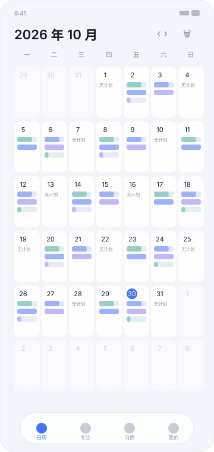
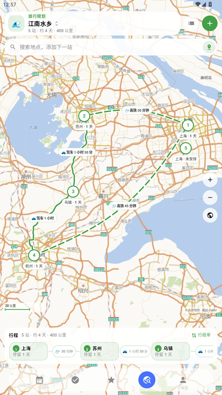
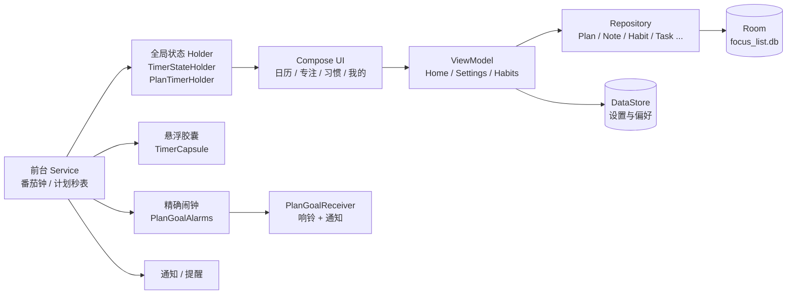

<p align="center">
  
</p>

<p align="center">
  
  
  
  
</p>

**暖历**是一个以离线为主的 Android 时间管理应用：以日历为入口安排跨日期计划，用秒表记录每天的真实投入，再用番茄钟与备注把「规划 → 执行 → 复盘」串起来；新增的「行程」页还能把下一趟旅行直接画在地图上。所有计划、记录与行程都只保存在本机；只有旅游规划里的地图底图与真实道路路线需要联网获取，不会上传任何个人数据。

---

## 开屏：暖历 · 一句话手写

- **每次冷启动随机**抽一条格言（`WarmQuotes`，12 条），图标弹入 → 品牌名淡入 → 正文与署名被逐字「写」出来 → 淡出进主界面；轻点任意处可跳过，从通知 / 小组件直达时不显示开屏；
- 手写感由四层叠出：**毛笔手写字体** + 每字固定的微小倾角 + 从左往右的笔迹揭示（`clipRect`）+ 笔尖墨点跟随；约 46ms 一个字，写完自动收尾；
- 字体用 **Ma Shan Zheng 毛笔楷书**（SIL OFL 1.1，许可证见 `docs/OFL-MaShanZheng.txt`），经 `pyftsubset` 按开屏文案子集化后只有 81KB，不会把 APK 撑大；
- 进度读在 `graphicsLayer` / `drawWithContent` 里（延迟读取），动画每帧只失效图层、不重组整句，30 多个字也不掉帧；
- 格言是**为暖历写的原创短句**，署名是带梗的身份泛称（某位韩国前总统 / 币圈老兵 / 夜班人……），不冒充真实人物原话、不涉及政治评价或投资建议；要换成考据过的真实语录，只改 `WarmQuotes.ALL` 里的 `text` / `author` 两个字段（新增汉字需重新子集化字体）。

## 界面预览

<table>
  <tr>
    <td align="center"><br><sub>日历首页：格子内直接看到进度</sub></td>
    <td align="center"><br><sub>专注页：唱片式光环 + 番茄钟</sub></td>
    <td align="center"><br><sub>当日计划卡与备注</sub></td>
    <td align="center"><br><sub>备注全屏页：查看 / 编辑</sub></td>
  </tr>
</table>

<p align="center">
  
</p>

> 以上为示意图（由 `docs/images/gen_mockups.py` 生成），实际界面以应用为准。

---

## 项目宣传片

[`video/today-plan-promo.mp4`](video/today-plan-promo.mp4) —— 36 秒、1920×1080 / 25fps、配 **128 BPM 原创电子流行 BGM**（程序合成，无版权素材），可发 B 站 / 视频号。

| 时间 | 内容 |
| --- | --- |
| 0–5s | 开场：图标落位 + 「暖历 · 把日子一格格攒暖」 |
| 5–12s | 日历：格子内的进度、滑动翻月、点开某天开始计时 |
| 12–19s | 专注：唱片式光环、三种白噪音、五种提示音 |
| 19–26s | 悬浮胶囊：后台可见、多计划逐行、拖动与配色 |
| 26–32s | 备注：全屏页面、Markdown 与附件 |
| 32–36s | 结尾：Logo + 数据本地优先说明 |

**重新生成**（全部资源都是代码产出的，可随时改文案重做）：

```bash
python video/make_audio.py          # 合成 36s BGM（128 BPM，底鼓/拍手/贝斯/琶音/Pad）
node video/render.mjs               # 逐帧渲染（Chromium + CDP，输出 .tmp_docs/frames）
ffmpeg -y -framerate 25 -i .tmp_docs/frames/f%05d.jpg -i .tmp_docs/promo.wav \
  -c:v libx264 -preset slow -crf 20 -pix_fmt yuv420p \
  -af "loudnorm=I=-16:TP=-1.5:LRA=11" -c:a aac -b:a 160k \
  -shortest -movflags +faststart video/today-plan-promo.mp4
```

> 动画在 `video/promo.html` 里由 `window.seek(t)` 驱动，时间轴可精确到帧；想改文案、节奏或配色，改这个文件即可。
> BGM 为纯合成音源：抖音热门曲库中的歌曲均有版权，不能直接随片分发；这里用同风格的原创律动替代。


---

## 功能一览

### 📅 日历（首页）

- **月视图**铺满屏幕，每个日期格最多显示 3 条计划：每条是迷你进度条，越接近当日目标颜色越深，行尾显示完成率数值；
- **左右滑动翻页**，跟手移动 + 惯性吸附，预渲染相邻月减少卡顿；滑动过程中点击不会误触日期格，松手后才响应；
- **点某一天**进入当日卡片页：渐变方卡、右上角开始/暂停秒表、**点卡片看这个计划的投入统计**、长按菜单（投入统计 / 补录时长 / 存为模板 / 删除）、「管理」多选批量删除；
- **按日期范围删除**（右上角功能菜单 → 🗑️ 删除计划）：只移除区间内的部分，范围外日期自动保留（覆盖中间时计划会被拆成前后两段）；
- 格子高度自适应屏幕，底部自动避开系统导航条与悬浮 Dock。
- **右上角功能菜单**：渐变圆形按钮（Apps 网格图标，非加号），点击向下展开玻璃胶囊菜单，含 ⚡ 一句话建计划、📋 添加计划、📝 备注、🧳 添加旅游规划、🗑️ 删除计划五个入口；菜单接近不透明保证可读，整行均可点击；
- **文字永远可读**：进度填充调淡到 28% 不透明度，标题与完成率数字统一深色——任何计划色下都读得清，也不再出现黑白混杂。
- **不再闪空白**：冷启动首帧数据没到时显示与真实布局同构的**骨架屏**（标题 / 建议条 / 星期表头 / 6 行格子，缓慢呼吸），数据到达后淡出；
- **进出卡片页是对称的，而且跟手**：点某一天，日历纵向收起、卡片页从下方顶上来；返回时日历展开、卡片被原样挤回去（进出走同一条曲线）。接了 Android 的**预测式返回**：从屏幕边缘往里滑时，`PredictiveBackHandler` 的 progress 直接映射成收展比例（`BACK_FOLLOW = 0.5f`，即滑到系统允许的最大距离时动画走一半），松手完成手势就是返回，中途放弃则弹回卡片页；两块内容都按整屏高测量、只裁掉看不见的部分，所以过程中不会把日历「压扁」。
- **性能**：收展比例在测量/绘制阶段读取（`Modifier.layout` + `graphicsLayer`），手势每帧只重跑布局和绘制，不触发重组。
- **卡片自由摆放**：长按卡片拖到任意位置，松手吸附到最近空格；右下角是一个更大的白色圆角角标，**按住直接拖**，拖动中卡片宽高实时跟手，松手才吸附到 `1×1 / 1×2 / 2×1 / 2×2 / 1×3 / 3×1` 六种规格；缩放时若旁边有卡会临时盖住，松手后该卡置顶（重开也保持），长按可挪开。位置与大小写入数据库，之后不会再自动重排。卡片内容按实际宽高自适应，计时按钮和缩放手柄都有独立留白，不会压住文字。

### 🗺 旅游规划：把下一趟旅行画在地图上

Dock 新增第五个入口「**行程**」：全屏地图 + 顶部搜索 + 底部横向行程条，搜索、停留、交通、连线一次排完。

- **搜索位置**：内置约 250 个常用目的地（城市 / 古镇 / 景区 / 海岛 / 境外热门），按名称、别名、省份即时搜索，输入「成都市」也能命中；也可以直接**长按地图任意位置**落点，或点搜索条右侧的图钉进入「点地图选点」模式；
- **停留时长**：每一站都能设置待多久（1 小时 / 半天 / 1 天 / 一周等快捷项 + 分钟级加减），地图上的地点标签直接显示「成都 · 2 天」；
- **选择行程方式**：站与站之间选飞机、高铁、火车、大巴、公交、地铁、自驾、邮轮、骑行、步行或其他，共 11 种；
- **站点 / 线路按方式收集**：
  - 飞机 / 高铁 / 火车 / 大巴 / 邮轮：出发与到达站点（机场 / 车站 / 港口，带常用站点建议）+ 航班号 / 车次 / 班次；
  - 公交：填写公交线路（如 `302 路`），并可保留上车站 / 下车站；
  - 地铁：按城市列出线路，多选并记录换乘顺序（`1号线 → 2号线 → 4号线`），没有收录的城市可自己添加线路名；
- **真实路线 vs 弧线示意**：公交、大巴、自驾、骑行、步行会向 OSRM 请求**真实道路折线**，地图沿着街道画；飞机、高铁、火车、地铁、邮轮没有公开轨迹，用不同弧度的平滑弧线表示（飞机弧度最大、步行几乎笔直），一眼能分出「飞的」还是「走的」；
- **线上标注**：上一站与下一站一定有线相连，线中间是一枚「方式 + 时长」标签（`🚄 高铁 4 小时 30 分`）；没填时长的段显示「时长待定」，缺失的段用灰色虚线提示去补；
- **地点标注**：编号圆标 + 「名称 · 停留」，点圆标或下面的标签都能打开编辑；
- **行程单**：底部「行程单」按「站点 → 交通 → 站点」竖排展开，列出每段的站点 / 车次 / 地铁换乘 / 里程，顶部汇总「停留 / 在路上 / 里程」与约几天（天数取停留天数与在途天数的较大值：2 天停留 + 1 小时车程仍是 2 天，30 小时火车才会跨天）；
- **多条行程 + 模板**：行程库可新建、改名、换封面色、删除；内置「川西小环线 / 江南水乡 / 云南慢行 / 关西漫步」四条模板，点一下生成带地点的完整行程，再按自己的节奏改；
- **坐标对齐**：底图用高德瓦片（GCJ-02），内置地点与 OSRM 轨迹是 WGS-84，绘制前自动纠偏，境内不会整体偏 500 米；境外坐标原样使用；
- **离线也不散架**：底图没加载时显示纸面网格与「底图需联网」提示，行程与路线仍可编辑；联网后进入行程会自动补真实路线并缓存进数据库，之后断网也能看到上次的折线。
- **边缘滑动跟手返回**：地图主页接了 Android **预测式返回**，`progress` 1:1 映射成**整页水平右移的距离**——页面宽高完全不变，不缩放、不淡出、不圆角；滑多少就向右移多少，左边同步露出「上一页」（与日历主页同构的静态预览：月份标题 / 建议条 / 星期表头 / 6×7 格子 / 底部 Dock，带轻微视差）。滑到最大时当前页整页移出、上一页完全显示，松手即返回，中途放弃弹回原位。进度在 `graphicsLayer` 里延迟读取，手势每帧只改图层、不重组整张地图；有弹层或选点态时返回键先收起最上层，不会一下退出地图页。

<p align="center">
  
  <br><sub>江南水乡模板：高铁走虚线弧线、驾车沿真实道路；线上是方式 + 时长，地点下是名称 + 停留</sub>
</p>

> 隐私边界：行程、站点、交通与缓存折线都只写本机 Room；联网请求只有「某块地图瓦片」与「某两点的路线」，不携带账号或其它记录。真实路线服务地址可在 **行程库 → 真实路线服务** 里换成自建 / 镜像 OSRM。

### 🧭 「现在」建议条：此刻最值得做的那件事

- 日历上方常驻**一条**建议，不外挂弹窗、不打断操作：图标 + 一句话 + 底部细进度线；
- 六种判断按优先级给出**唯一**答案：今天没有计划 ✨ → 正在计时 ⏱ → 全部达标 ✅ → 深夜收工 🌙 → 全新开始 ▶ → 最接近达标 🎯；
- **先易后难**：多条计划都没达标时，挑「离达标最近」的那个（`再 5 分钟达成「读书」`），先拿到正反馈再谈别的；
- **点一下就开工**：右侧「开始」胶囊直接启动该计划的秒表；没有计划时点开 **⚡ 一句话建计划**；其余情况点进今天的卡片页；
- **不制造焦虑**：22:30 之后若还没做完，话术换成「今天先到这里，明天补上，别熬夜」，不再催进度；
- 时钟每分钟刷新一次，「夜深了」这类建议会自己切换，不需要手动刷新。

### 🗓 周条：在日卡片里横向翻日子

- 当日卡片顶部有一条**周条**：周一到周日 7 个圆点，星期在上、几号在下；
- 圆点就是**迷你热力图**：浅色=动过、中色=过半、实心主色=达标，没有记录的日子几乎透明，不抢眼；
- **点一下切那天**，不用先「返回日历 → 找格子 → 再点进去」；跨月的那一周会自动把月历翻到对应月份（顺带修掉了搜索跳转后月历与数据不同步的问题）；
- 左右箭头**整周前后翻**：看上周怎么练的、把下周提前安排一眼，两下就到；
- 底部一句本周小结：`本周 3/4 天达标 · 4 小时 20 分`——分母是**已过的天数**（含今天），周一不会一上来就说「0/7 天达标」；整周都在未来时改说「这一周还没有开始，已安排 2 天」；
- 数据按周单独取一次（`weekLogs`），跨月的那几天数字也准，不会因为不在当月网格里变成 0。

### 🌙 收工小结：给一天一个结束的动作

- 当日卡片右上角会出现「**收工**」——只在**还有计时在跑**或 **21:00 之后**露面，白天不打扰；
- 点开是一张今日小结：总时长、达标 x/y、逐计划投入（按分钟从多到少排，最多列 5 个）；
- **一键暂停全部计时**：并行秒表原本只能一个个停，忘记停表会把第二天的时间一起算进去，这里一次收尾；
- 暂停后弹层不关，会立刻看到「计时中」消失、达标数更新；
- 结语按情况换：全部达标「可以安心收工了」、晚上「今天先到这里，明天继续」、白天「「读书」还差 10 分钟，或者就到这儿」；
- 旁边还有「写一句今天」，直接跳到当日备注——把结束动作和复盘连在一起；
- **存进备注**：一键把小结写成当天的一则 Markdown 备注（标题固定为「收工小结」），内容形如：

  ```markdown
  ### 收工小结 · 11 月 1 日
  **今天 2 小时 10 分** · 达标 3/4

  - 写作 60 / 30 分钟 ✅
  - 读书 40 / 30 分钟 ✅
  - 健身 10 / 30 分钟

  > 「健身」还差 20 分钟，或者就到这儿
  ```

  同一天再打开会显示「已存进备注 ✓」并禁用，不会写进第二条；想改就点开备注自己补两句。

### ⏱ 计划与秒表

- 计划是**跨日期区间的实体**（起始日 ~ 截止日 + 每日目标时长），不是单日任务；
- 支持**多个计划并行计时**，暂停只冻结不清零，再点继续接着累加；
- 基于 wall clock 换算，息屏、切后台、退进程都不影响真实秒数；
- 运行时前台服务常驻**系统计时器样式通知**，退后台兜底落库；
- **到达每日目标的提醒**：响铃与震动时长各自可在 **1–20 秒**内调节（循环响铃 + 波形震动）；
- 提醒由 **AlarmManager 精确闹钟**兜底：即使应用被系统冻结或进程被杀，也会在目标时刻准点提醒。

### 📆 导出到日历（.ics）

- 长按计划卡 → **导出到日历（.ics）**：生成一个标准 iCalendar 文件，用系统日历、Google 日历或 Outlook 打开即可导入；
- **旅游规划也能导出**：行程库（🧳 → 行程列表）里每条行程有 📅 导出按钮，生成**一个覆盖整段日期的整天事件**（不按天重复），描述里写备注与「西安北 → 兵马俑 → 回民街」这样的路线；没设日期的行程退化成今天一天；
- 计划会变成**每天重复的整天事件**（`DTSTART;VALUE=DATE` + `RRULE:FREQ=DAILY;UNTIL=截止日`），一个事件覆盖整段，日历里不会塞满 N 条；
- 事件标题带每日目标（`写作 · 每天 30 分钟`），描述里写备注与总天数，`TRANSP:TRANSPARENT` 让同事看到的是「空闲」而不是「忙碌」；
- **不申请任何日历权限、不联网**：只生成文件，导入与否完全由你决定；同一计划重复导入不会产生两条（UID 固定为 `focuslist-plan-<id>`）；
- 实现细节都在 `util/Ics.kt`：CRLF 换行、**75 字节折行**（中文按 UTF-8 三字节算，不能按字符切）、逗号 / 分号 / 反斜杠 / 换行转义——这三条是各家客户端解析失败的常见原因，全部有单测钉住。

### 🔥 计划投入统计：点开卡片看节奏

- **点任意计划卡**（非管理模式）直接打开投入统计：今天做了多少、这几天稳不稳、一共积累了多少；
- 顶部是**今日进度条**，下面一句「今天还差 8 分钟达标 / 今天超出目标 10 分钟」；
- 三个关键数字：**连续达标**、**最长连续**（回溯 90 天，可能长于展示窗口）、**达标率**；
- **最近 14 天柱状图**：柱子按当天目标归一化，达标满格实心、未达标淡化、空白日留一个短横；点任意柱子看「11月3日 · 45 分钟 · 达标」；
- 口径克制：窗口只统计**计划有效期内**的日子，计划还没开始就是空态，不会一上来显示 0%；
- **计划结束后**窗口自动锚到最后一天，仍能看到它收尾时的 14 天，而不是一片空白；
- 连续达标沿用应用内其它地方的约定：**今天还没达标时从昨天往回数**，但计划已结束就不再宽容（最后一天没达标就是 0）；
- 长按计划卡的菜单里也加了「查看投入统计」，入口不止一个。
- **卡上就能看见欠账**：今天的计划卡如果整体落后，标题下方会出现一枚 `落后 2 天` 的白色小角标；按节奏推进、超前、刚开始都不显示——**只有落后才出现**，所以它一出现就值得看一眼；
- **整体进度**：弹层顶部把「时间过了多少」与「目标完成多少」放在一起比——一条投入进度条 + 一根时间刻度线，柱子落在刻度线左边就是落后；
- 结论直接说人话：`落后约 5 天，需要加把劲` / `比时间进度快 12%` / `按节奏推进中` / `刚开始，先跑几天再看节奏`（3 天内不评价，避免第一天就打击人）；
- 还会算出**按时完成每天需要多少分钟**：`还剩 8 天，每天需 42 分钟才能按时完成`；最后一天不再说「还剩 0 天」，改成「今天是最后一天，还需 42 分钟」；
- 口径：总天数含首尾、已过天数含今天、目标总量 = 总天数 × 每日目标；落后天数**向上取整**，差 1 分钟也算落后 1 天。

### ⚡ 一句话建计划

- 右上角功能菜单的 **⚡** 入口：一行文字同时写清名称、图标、每日时长与日期区间，**回车即存**；
- **边打字边解析**，下方实时预览「图标 + 标题 + 每天 X 分钟 + 起止日期 + 共 N 天」，所见即所得；
- 时长：`30 分钟` / `1小时30分` / `45min` / `半小时` / `一刻钟`，自动夹到 5–480 分钟；
- 日期：`今天` / `明天` / `后天` / `大后天` / `周一`…`周日` / `下周一` / `周末` / `11月1日` / `11.5` / `2026-12-01` / `月底` / `年底`；今年已过的月日自动顺延到明年；
- 区间：`11月1日-11月30日`、`从今天到年底`、`坚持 21 天`，只写截止日时起点默认今天；
- emoji 直接当图标，没写则按关键词猜（读书 📚、健身 💪、跑步 🏃、冥想 🧘…），主题色按标题稳定生成；
- **口语也能听懂**：`帮我建3个月的健身规划` 会得到名称「**健身**」、时长 **3 个月**（90 天），而不是把整句话当名字——「帮我建 / 创建一个 / 做个」这类命令前缀和「规划 / 计划」这类收尾词都会被剥掉，且剥完不会留空标题。

### 🧩 计划模板：一次配好，之后一键复用

- **自动沉淀**：每次添加计划（手动表单或一句话），这套「图标 + 名称 + 每天 X 分钟 + 持续 N 天 + 配色」会自动存成模板，**不用额外操作**；
- **一键填入**：添加计划 / 一句话建计划的顶部有模板条，**点一下**把全部字段填好，日期自动从今天重新起算；一句话模式下模板会反写成一句可编辑的话，仍走同一套解析；
- **长按计划卡 → 存为模板**：把已有的计划原样存成模板（持续天数按起止日期自动换算）；
- **越用越靠前**：模板按复用次数排序，最多保留 24 条，超出自动淘汰最不常用的；
- **我的 → 计划模板** 可查看「每天 X 分钟 · 共 N 天 · 用过 N 次」并删除；模板条上长按 chip 也能直接删。

### 🔍 全局搜索

- 首页顶栏 **🔍** 进入搜索：顶栏原地变成搜索框，**自动弹出软键盘**，退出即回到日历；
- **跨类型一起搜**：计划（标题 + 说明）、备注（标题 + 正文）与**旅游规划（标题 + 备注 + 经过的地点）**混排成一个结果列表，右上角标注「计划 / 旅游 / 日期」；搜「西安」也能找到经过西安的行程；
- **四档排序**：全等 > 开头 > 词首 > 中间包含，同一档内越靠前越靠前排；**标题权重是正文的 3 倍**，标题命中的永远排在正文命中的前面；
- **多关键词按空格拆分**，全部命中才算数（顺序无关），并忽略大小写；
- **命中片段高亮**，备注自动截取命中位置附近的摘要（两侧补省略号，换行压成一行）；
- 点计划 → 日历翻到该计划生效期内离今天最近的一天并展开当日卡片；点备注 → 直接打开备注详情；点旅游行程 → 打开对应的规划页；
- 进入与退出搜索都有淡入淡出过渡，切换不生硬。

### 🍅 番茄专注

- 专注 / 短休息 / 长休息时长与长休息间隔，用 `− 值 +` 步进器调整，配置在专注页内（齿轮入口）；
- **唱片式光环**：42 圈长短交错的同心弧缓慢自转（26s/圈），叠加反向扫光与 7 秒呼吸缩放，休息阶段自动切冷色调；
- **白噪音三种模式**各有画面：静音是柔光呼吸，白噪是冷蓝光场 + 漂浮光尘，棕噪是暖琥珀 + 底部声浪；
- **5 种提示音**（清脆铃 / 木鱼 / 水滴 / 颂钵 / 柔音）点选即可试听，番茄与计划提醒共用；
- 自动化开关：番茄结束自动休息、休息结束自动下一番茄、严格模式；
- **防烧屏**：计时中内容以极小幅度缓慢漂移（暂停即冻结、继续从冻结点续跑）；Dock 仅在**专注页**或**日历当日卡片页**计时时收起，5 秒后隐藏、触摸任意位置临时唤出。

### 📝 备注

- 备注是**全屏页面**：新建 / 查看 / 编辑三态共用，查看态右上角「编辑」直接切换；
- 每条备注可设**标题**与**关联日期**（默认当前查看的那天），也可不关联日期作为随手记；
- 正文支持 **Markdown**：标题、加粗、斜体、列表、引用、链接、在线图片；
- 支持**关联本地图片 / 视频**（系统选择器 + 持久读权限），详情页可预览或用系统应用打开；
- 当日计划页底部按日期展示备注，**默认最多 3 条**，超出可展开，内容过长省略显示，点击进入详情。

### 🫧 悬浮计时胶囊

- 应用退到后台时，屏幕上方浮出玻璃质感的计时胶囊，显示正在进行的计划；
- **多计划逐行展示**：每行是状态点 + 标题 + 剩余时间 + 细进度条，最多 3 行，超出显示「… 还有 N 个」；
- 时间显示**距今日目标还剩多少**，超出目标显示负值（如 `-03:20`）；
- **外观完全可自定义**：背景 / 文字 / 进度条各自的颜色与不透明度、胶囊宽度与行高（0 = 自适应内容）；
- **可任意拖动**：按住拖到屏幕任意位置，松手自动记住，轻点回到应用；
- 说明：ColorOS 的流体云 / 灵动岛不向第三方开放，这里用系统悬浮窗实现了同形态胶囊。
- **进度条自绘**：不再用系统横向进度条（部分 ROM 会在进度走满后显示成红色），改为两笔圆角矩形自绘，颜色永远跟随计划主题色，超出目标也只按 100% 显示；
### 📊 专注统计与年度热力图

- 入口：**专注页右上角统计按钮**（Insights 图标）；设置页里不再放统计入口，打开专注页就能一眼看到；
- 今日 / 本周 / 本月 / 累计专注与番茄数、连续天数，以及**本周每日分布柱状图**；
- **年度专注热力图**：GitHub 贡献图风格，列 = 周、行 = 周一…周日，颜色越深表示当天专注越久；横向可滚动，进入页面自动滚到最近一周，**点击任意格子**即可查看当天具体分钟数；
- **年度总览**：过去一年的累计专注（时 + 分）、活跃天数、最佳单日、最长连续与活跃日日均。

### 📈 本周回顾：和上周同期比一比

- 统计页「本周每日分布」下方新增**本周回顾**卡：本周（周一至今）的专注时长，与**上周同一区间**对比 —— 只比已经过去的那些天，周一早上不会出现「比上周少 83%」这种假下降；
- 标题右侧是**趋势徽标**：`↑ 33%` / `↓ 12%` / `持平`；上周同期没有记录时显示「新起点」，两周都还是空白时整张卡收成一行提示；
- **双条对比**：上周同期与本周共用同一比例尺，条形长度直接可比，右侧标出各自分钟数；
- **指标行**：达标 X/Y 天（没设每日目标时换成活跃天数）、最佳单日是周几与多少分钟、同期日均；下方还有按当前日均推算的整周总量（如「按当前节奏，本周预计 420 分钟（还剩 4 天）」），周日自动变成「本周已完整记录」；
- 数据层把本周与上周的逐日聚合合并成**一次分组查询**（原来要连查 7 次），统计页刷新更快。

### 📅 月度回顾：整月日历 + 上月同期对比

- 入口：**专注统计页**「本周回顾」下方的**月度回顾卡**；
- 顶部**月份切换条**：左右箭头翻看最近 12 个月，点中间任意位置一键回到本月；
- **整月逐日日历**：7 列网格按当天专注时长分五档着色（有每日目标时按目标占比，没设目标时按绝对分钟数），今天描边、未来日期压暗，**点任意一天**在下方看到「11月5日 · 1 小时 30 分 · 已达标」；
- **同期对比**：本月只和上月**同一区间**比（17 号就比上月 1–17 号），用双条对比 + 趋势徽标 `+150% / -50% / 持平`，不会在月初给出「暴跌」的假结论；
- 汇总区给出**整月累计**（时 + 分）、**日均**（按已过天数均摊）、活跃 / 达标天数、最佳单日，以及按当前节奏推算的**整月预计**；
- 全程只查一次库（一次分组查询取回 12 个月的逐日数据），翻月不再读盘。

### 🗂 计划时间轴：这 6 周你同时扛了几件事

- 统计页新增「**计划时间轴**」卡：窗口是**前 2 周 + 本周 + 后 3 周**共 6 周，**一格 = 一周**；
- 每个计划一条泳道，条带颜色就是计划主题色，**今天所在列**有淡色底；
- 一眼看出**重叠与空档**：三个计划压在同一个周末，画面会立刻显形；中间空出一周，也一眼能看到；
- **点任意一行**看它的具体区间：`写作 · 10月12日 - 11月2日 · 每天 30 分钟`；
- 底部一句 `3 个计划 · 最多同时 2 个`；同时在跑 ≥3 个时换警示色并补一句「排得有点满」——只陈述事实，不打分；
- 布局是**贪心分行**：重叠才换行、不重叠复用第一行，所以行数天然等于「同一时刻最多并行几个计划」，也就成了过载的量化指标；
- 按周取整（周三开始也算占满那一周），6 周在手机上才画得开；超出窗口的计划自动裁剪到边缘。

### 🕐 专注节律：你通常在几点专注

- 统计页新增「**专注节律**」卡：把过去一年的番茄按**本地小时**铺成 24 根柱子，一眼看出自己是一早进入状态还是夜猫子；
- 24 小时再归成 **六大时段**（凌晨 / 清晨 / 上午 / 午间 / 下午 / 晚间），每条给出占比与分钟数，**黄金时段**用高亮色标出；
- 「**黄金时段是「上午」8–12 点，占 42%；峰值出现在 9 点、14 点、20 点**」这类一句话结论直接写在卡片顶部；
- 底部还有**工作日 / 周末日均对比**（谁更投入、差多少分钟），周末掉队也能立刻发现。

### 🎯 每日专注目标

- **我的 → 每日目标**设置每天想专注多久：15 / 30 / 45 / 60 / 90 / 120 分钟一键选，也可以按 ±5 分钟微调（范围 5–480）；
- 按近 14 天的实际表现**推荐目标**（取有效日中位数并向上取整到 5 的倍数），一键「采用」；有效样本不足 3 天时给默认值 30 分钟；
- 统计页顶部**目标进度环**：显示完成百分比与「已完成 / 目标」分钟数，配一句话进度文案，下方还有**连续达标天数**与**本周达标 X/7 天**；
- 本周柱状图叠加**每日目标虚线参考线**，达标当天柱子为实心、未达标淡化，一眼看出哪几天掉队。

### ✅ 习惯与小组件

- 习惯打卡、连续天数统计；
- **每日提醒**：新建习惯时就能选一个时间，之后每天准点提醒一次——卡片上的 `⏰ 每天 21:30` 点一下改时间，旁边的 `×` 关掉；
- 提醒用**每日单次精确闹钟**（不是 `setRepeating`）：Doze 下更可靠，重启后开机广播会按当前时分自动重排；
- 是否继续提醒**以数据库为准**：习惯被删除或提醒被清空后，即使旧闹钟已经触发，也不会再响、更不会把闹钟排回去；
- 点通知直接进**习惯页**（不是首页），省一次手动切换；
- 四款**桌面小组件**：任务列表、番茄计时、统计概览、习惯打卡。
- **大肥鱼桌宠**：首页右下角常驻 DeepSeek 大肥鱼，用 Android 原生 `ImageDecoder` 播放 animated WebP（不是只显示第一帧的假静态图）；**点头部摸摸头**、点身体戳一下、点尾巴吐泡，头顶会冒出台词气泡；拖动时播放拖拽动画、松手站稳，空闲会伸懒腰 / 打哈欠 / 吃 token。添加入口已收进右上角功能菜单，底部不再有悬浮按钮挡住桌宠。

### 🏆 成就殿堂：把长期坚持收集成徽章

- 入口：**专注统计页右上角奖杯图标**；
- **12 枚徽章**覆盖三档稀有度：初次专注 / 番茄新手 / 十小时 / 三日连续 / 深度一日（铜牌）、百颗番茄 / 百小时 / 早起鸟 / 夜猫子 / 周末不休（银牌）、月度坚持 / 百日足迹（金牌）；
- 徽章墙**两列铺开**，已解锁的排在前面（按解锁时间倒序）并标出解锁日期，未解锁的整体压暗、显示「300 / 600 分钟」这样的进度；
- 顶部总览给出**已解锁 x / 12**、整体完成度进度条，以及一句带节奏的激励文案（如「距离「十小时」还差 300 分钟 · 约 6 天」）；
- **点任意徽章看详情**：达成条件、当前进度、点亮时间，以及一枚徽章最想知道的事——**还要多久**；
- **达成预测分三类口径**：累积型（时长 / 番茄 / 活跃天数 / 时段）按**近 14 天（不含今天）**的日均增量外推天数；单日最高只说「需要有一天专注满 X 分钟」；连续天数只说「还要连着 X 天」——峰值与连续从不硬套日均，宁可不说也不给假数字；
- 详情里还列出**同类徽章**（同指标的上下档），顺手看到下一档还差多少；
- 指标全部取**全量口径**：累计时长、番茄数、活跃天数与最长连续都算全部历史，不受统计页一年窗口截断；
- **解锁不可逆**：一旦点亮就永久保留，即使之后历史记录被清理、进度回落，徽章也不会消失；
- **随备份一起走**：解锁记录写进备份 JSON（schema 3），换机或重装后徽章与**解锁日期**都能原样恢复；
- 每次刷新统计时自动结算，新解锁的会在成就页顶部打出「🎉 新解锁：早起鸟」提示。

**本周挑战**：长期徽章之上再加一层「这周还差多少」

- 成就页顶部总览下方是「**本周挑战**」卡，固定三条：**本周专注 N 天** 📅 / **本周累计 N 小时** ⏳ / **单日专注 N 分钟** 🔥；
- 三条覆盖「坚持 / 强度 / 爆发」三种不同的努力方式，**目标值每周轮换**（天数 4↔5↔3、累计 3↔4↔5 小时、单日 45↔60↔90 分钟），不换类型，规则才看得懂；
- 轮换只依赖「周起点距 1970 年有多少周」，同一周在任何设备上算出来都一样，所以**没有额外存储来存进度**：周一进度自然归零；
- 卡片右上角写「剩 N 天」，最后两天换成提示色；完成的挑战打勾并写入成就存储（幂等），换机后仍能在备份里看到「哪一周完成过什么」；
- 底部一句 `本周 2/3 个挑战完成`，全部完成时变成「本周挑战全部完成，漂亮」。


### 🎓 结业的计划：到期给它一个交代

- 计划到期后原本是**一声不响消失**的——首页看不到、也没有任何提示，很容易以为数据丢了；
- 统计页底部因此多了一张「结业的计划」卡：**最近 30 天结束**的计划，最多列 3 个，按结束日从近到远；
- 每个都有一张成绩单：`完成度 78%，只差一点点` + `共 30 天 · 累计 12 小时`。评语只按完成度分档，不评判努力程度（0% 也会说「计划曾经被你认真安排过」）；
- **再来一版**：同配置从今天重新起算、天数不变，同时**把旧的一版归档**——否则结业列表里会一直挂着它；
- **归档**：不想继续了就收进归档，首页与结业列表都不再出现；
- 没有已结束的计划时整张卡不渲染，统计页保持干净。

### ⚙️ 我的：一行一个入口，点进去再改

设置项变多以后，全部铺在一页里会变成一个超长表单。现在「我的」只留入口：**外观 / 每日目标 / 提醒 / 计划模板 / 悬浮胶囊 / 地图与搜索 / 数据备份** 各占一行，每行是「emoji + 名称 + 当前状态摘要 + ›」，不点进去也能看出现在是什么配置（例如「跟随系统 · 滴答蓝」「3 天前备份 · 良好」「高德 Key 已配置」）；点进去是独立的设置页，顶部有返回箭头，只放这一组控件。**统计类入口不放在设置里**：日历主页右上角是「计划统计」，专注页右上角是「专注统计」，各自和数据源待在一起，打开即见。设置页底部只留一行指路文案，最下面是「关于」。

### 📊 计划总览：统计日历里的计划，不是番茄专注

- 入口：**日历主页右上角统计按钮**（Insights 图标，日历展开时显示）；数据源是 `plan_logs`（日历格子、日卡片进度条背后的那份数据），和专注统计用的番茄记录**完全分开**；
- 今日 / 本周 / 本月 / 累计投入四宫格，附活跃天数、达标天数、最长连续、最佳单日；
- **本月计划日历**：7 列周一起始，按当天全部计划的合计投入分五档着色（对照每日目标），今天描边，底部带色阶图例；点开「计划节奏」还能看 6 周计划时间轴与到期计划的结业成绩单；
- **近 14 天柱状图**：达到每日目标当天为实心柱，其余淡化；**各计划投入排行**用计划自己的主题色画占比；
- 计算逻辑放在纯 JVM 工具 `PlanStats`（先按天累加秒再换算分钟，避免多个计划各不足 1 分钟被逐个取整抹成 0），单测 13 条；
- 计划节奏（6 周时间轴 / 结业的计划）从**计划总览页底部**进入；专注统计页里自带月度回顾卡与成就殿堂奖杯入口，所以设置页删掉那三个入口后整条统计链依然可达，不会变成孤岛。

### 🔑 高德 Key：编辑与确定分开

「我的 → 地图与搜索」里的 Key 改成**显式保存**：默认只读展示打码后的已保存值（只留后 4 位便于核对），点「编辑」才进输入态，点「确定」才真正写入本机偏好并回显「✓ 已保存，下次搜索立即生效」；「取消」丢弃草稿，留空并确定则清空。不会再出现「边打字边悄悄存、用户不知道存没存」。

### 💾 数据备份与恢复

- 一键**导出**：把计划、投入记录、番茄记录、任务、习惯、备注与附件、**旅游行程（含站点、交通、路线折线与卡片摆放/叠放顺序）**，外加**偏好设置**、**计划模板**与**成就解锁记录**，整体写成一个 JSON 文件（系统「另存为」选择保存位置，文件名自动带日期）；
- 一键**导入**：选一个备份文件后先预览摘要，再选**覆盖导入**（清空本机后写入，结果等同于备份，并还原设置、模板、行程与徽章）或**合并导入**（保留本机数据与设置，仅覆盖相同 ID 的记录，补充本机没有的模板与**尚未解锁的徽章**，导入结果会告诉你有几枚徽章被补充）；
- 整个导出 / 导入的数据库部分都在**单个事务**内完成，要么整体成功要么整体回滚；
- **备份体检**：我的 → 数据备份，页首卡片显示「上次备份在 N 天前」与距 30 天提醒线的进度条，从未备份或临近 / 超过提醒线时给出导出建议；
- 备份文件带 `schemaVersion`（当前 4），版本不兼容时明确拒绝而不是写入脏数据；旧版本备份仍可导入（缺少的设置、模板、成就与行程自动跳过，本机徽章不会被清空）；
- 走系统文件选择器（SAF），**不需要任何存储权限**，文件始终由你自己保管。

---

## 技术栈

| 领域 | 选型 |
| --- | --- |
| 语言 / UI | Kotlin + Jetpack Compose（Material 3，玻璃拟态风格） |
| 数据库 | Room 2.6（本地 SQLite） |
| 偏好存储 | DataStore Preferences |
| 导航 | Navigation Compose，单 Activity + 底部 Dock |
| 异步 | Kotlin Coroutines + StateFlow |
| 后台 | 前台 Service（番茄钟 / 计划秒表）+ AlarmManager 精确闹钟 |
| 系统能力 | 通知、震动、悬浮窗（TYPE_APPLICATION_OVERLAY）、桌面小组件、系统文件选择器（SAF） |
| 地图 / 路线 | Compose Canvas 自绘地图（高德瓦片 + GCJ-02 纠偏）、OSRM 真实道路路线（可配置服务地址） |
| 数据交换 | Gson（备份 JSON 编解码，纯 JVM 库，可直接单测） |
| 测试 | JUnit 4 单元测试（`testDebugUnitTest`），覆盖日期工具、备份编解码、节律与目标等统计 |
| 构建 | Gradle Kotlin DSL + KSP，compileSdk 34 / minSdk 26 / JDK 17 |

## 架构



- **手动依赖注入**：`AppContainer` 按需 lazily 提供数据库、各仓库与设置存储；
- **全局计时状态**用单例 Holder（`StateFlow`）承载，界面、胶囊与桌面小组件都从同一处读；
- **数据库版本**：v1 任务/习惯 → v2 标签与软删除 → v3 计划与备注 → v4 备注标题/日期与附件表，升级走手写 `Migration` 保留旧数据。

## 目录结构

```text
app/src/main/java/com/focuslist/app/
├── MainActivity.kt          # 单 Activity，Dock 导航 + 路由 + 按页面隐藏 Dock
├── FocusListApp.kt          # 入口：通知渠道、依赖容器、音效预热、前后台追踪
├── data/
│   ├── local/               # Room：实体、DAO、数据库与迁移
│   ├── repo/                # 仓库层（计划、备注、习惯、任务…）
│   ├── backup/              # 备份：数据结构、JSON 编解码、导入导出管理器、成就快照与恢复策略
│   ├── prefs/               # DataStore 设置（时长、音色、胶囊外观、主题…）+ 行程模块轻量偏好
│   └── travel/              # 真实道路路线客户端（OSRM，可配置服务地址）
├── timer/                   # 番茄钟状态机与前台服务
├── ui/
│   ├── home/                # 日历主页（月历、翻页、当日卡片、范围删除）+ 「现在」建议条 + 收工小结 + 全局搜索
│   ├── focus/               # 专注页、唱片光环（TimerAura）、氛围背景、白噪音
│   ├── note/                # 备注全屏页、Markdown 渲染、图片加载、日备注卡
│   ├── habits/              # 习惯打卡
│   ├── travel/              # 旅游规划：自绘地图 / 地点搜索 / 站点与交通编辑 / 行程单 / 行程库
│   ├── common/              # 玻璃组件、Dock、FAB、提示音/提醒播放、防烧屏
│   ├── plan/                # 计划弹层（一句话建计划、模板条、投入统计）、秒表服务、计时持有者、悬浮胶囊
│   ├── settings/            # 我的（入口列表）+ 外观/目标/提醒/模板/地图/备份/胶囊子页
│   ├── stats/               # 统计页：目标环 + 总览卡 + 热力图 + 节律 + 计划时间轴；成就殿堂（徽章详情 + 本周挑战）
│   └── theme/               # 主题色与配色
├── notify/                  # 通知、目标闹钟与广播、开机恢复
├── widget/                  # 四款桌面小组件
└── util/                    # 日期工具、热力图、节律、目标、周/月回顾、投入画像、成就与预测、收工小结、日历导出、现在建议、一句话建计划解析、搜索打分、前后台状态、行程几何 / 文案 / 目的地库
```

## 构建与运行

环境要求：**JDK 17** + **Android SDK 34**（无需 Android Studio 也可以命令行打包）。

### 一键打包（推荐）

双击 `build.bat`，按提示操作：

1. **选择操作**：`1` 开发包 Debug（可调试，自测用）/ `2` 生产包 Release（分发用）/ `3` 运行单元测试（不打包）；
2. **输入版本号**：如 `1.0.53`，直接回车则沿用当前 `version.properties` 中的版本；
3. 脚本自动写入版本号并开始构建，结束后打印 APK 路径与 `adb install` 命令。

也可以命令行非交互执行（便于脚本化）：

```bash
build.bat debug 1.0.53
build.bat release 1.1.0
build.bat test              # 只跑单元测试
```

产物：

| 包类型 | 路径 |
| --- | --- |
| 开发包 | `app/build/outputs/apk/debug/app-debug.apk` |
| 生产包 | `app/build/outputs/apk/release/app-release.apk` |

> `versionCode` 每次打包后自动 +1，`versionName` 保留你输入的值。

### 正式签名

在根目录放 `keystore.properties`（字段见 `keystore.properties.example`）即可启用正式签名；
**没有该文件时 Release 会自动回退到 debug 签名**，保证产出的 APK 可直接安装（但不适合上架应用市场）。

### 直接使用 Gradle

```bash
./gradlew assembleDebug
./gradlew assembleRelease
```

## 自动化测试

单元测试放在 `app/src/test/java/`，全部是纯 JVM 测试，不需要模拟器或真机：

```bash
./gradlew :app:testDebugUnitTest      # 等价于 build.bat test
```

当前共 **691 条**用例，覆盖所有能脱离 Android 框架的纯逻辑（日期、解析、统计、文案、行程几何、目的地搜索与卡片自由排版）。

| 测试类 | 覆盖内容 |
| --- | --- |
| `util/DateUtilsTest` | 当天 0 点 / 当日最后一刻、跨月加减天数、周起点为周一、月初、`MM:SS` 倒计时（含负值） |
| `data/backup/BackupCodecTest` | 备份 JSON 导出→导入的字段级往返一致（含设置、模板与成就快照）、缩进可读且不转义中文、可空字段、非法 JSON 与不兼容版本被拒绝、旧版本备份缺少设置 / 成就时自动跳过、行程几何（含叠放顺序）与站点/交通往返一致 |
| `data/backup/BackupPayloadTest` | 备份条数统计（含模板与成就）、摘要文案列出模板、成就与设置、设置快照默认值 |
| `data/backup/BackupAchievementsTest` | 成就入备份：脏数据过滤（空 id / 时间非正）、快照按解锁时间倒序且同刻按 id 升序、同一 id 重复时取最早解锁时间、未知 id 保留、快照→记录往返一致、覆盖式整体替换、合并式只补缺失并保留本机解锁日期、旧备份空列表不清空本机、补充条数统计、JSON 往返（共 19 条） |
| `util/BackupNamesTest` | 备份文件名（前缀 / 时间戳 / 扩展名）与文件类型判断 |
| `util/BackupHealthTest` | 备份体检：距上次备份的自然日天数（同一天 / 昨天 / N 天前 / 未来时间归零）、健康分级四档边界、状态与建议文案、提醒判断、进度与倒计时文案（共 23 条） |
| `util/HeatmapTest` | 热力图等级四档边界、按周分列的网格排布与前置占位、每行对应正确星期、月份标签间距、连续天数（最长 / 当前 / 断档）、年度总览聚合、一年窗口约 53 列 |
| `util/DayKeysTest` | 日期串 ↔ 本地 0 点时间戳往返一致、同一天不同时刻归到同日、相邻两日相差一天 |
| `util/QuickPlanParserTest` | 一句话建计划解析：时长（含小时叠加、口语半小时、上下限夹取）、相对日与周几/下周、月日与完整日期、跨年顺延、区间与"到某天"、跨度天数与中文数字、标题清理与长度上限、口语命令前缀（帮我建 / 创建一个 / 做个）与「规划 / 计划」收尾词剥离（剥完不为空）、emoji 提图标、颜色下标稳定性（共 30 条） |
| `util/GoalTest` | 每日目标：取值约束到 5 的倍数与 5–480 区间、进度与百分比、剩余分钟、四档状态边界（0 / <60% / ≥60% / 达标）、达标天数统计、周目标与周进度、连续达标（今天未达标回落昨天）、按中位数建议目标与上下限夹取、进度文案（共 21 条） |
| `util/WarmQuoteTest` | 开屏格言数据：正文与署名非空、句子长度不撑破排版、按下标取模（负数 / 越界）、随机结果来自格言库、无重复句（共 5 条） |
| `util/PlanStatsTest` | 日历计划统计：按天先累加秒再取整、日/周/月/累计区间、活跃与达标天数、连续达标（今天未达标从昨天起算）、逐日窗口升序补零、计划排行（降序 + 平局按 id）、空记录与负秒容错、周一起始的月历网格、五档着色边界、时长文案（共 13 条） |
| `util/PlanTemplateTest` | 计划模板：标题规范化与截断、时长/天数上下限夹取、空标题拒绝、指纹去重、含首尾天数与跨月区间推算、由计划反推模板、合并时复用次数 +1 且不回退创建时间、超上限淘汰最不常用、双层排序、JSON 往返与脏数据容错（共 20 条） |
| `util/RhythmTest` | 专注节律：24 小时归一化（补齐/截断/负值归零）、时段划分边界与名称区间、时段聚合与占比、黄金时段与空态、峰值小时（降序 / 平局取小时小的 / topN）、一句话总结、周末判定、区间内工作日与周末天数统计、按天拆分与日均、工作日周末对比文案四种分支（共 26 条） |
| `util/SearchTest` | 全局搜索：分词（空白/标点、去重、大小写归一）、四档打分与基准值、多关键词 AND 语义、位置惩罚封顶、大小写不敏感、高亮区间（多处命中与相邻合并、条数上限）、摘要截取与省略号、换行压平、排序（标题权重、降序、剔除未命中、条数上限、命中字段下标）（共 24 条） |
| `util/WeeklyReviewTest` | 本周回顾：只统计已过天数（未来有数据也不计入）、达标/活跃天数、最佳单日（平局取靠前、无记录为 -1）、日均截断、今日下标夹取、短列表容错、趋势三态与徽标/对比文案、百分比取整与零基准保护、整周推算（末日等于实际值）、空状态判定（共 24 条） |
| `util/MonthReviewTest` | 月度回顾：月份键格式化与跨年翻月、月份越界规整、闰年二月天数、周一为 0 的起始偏移、`yyyy-MM` / `yyyy-MM-dd` 解析容错、当月只算已过天数（月末数据不计入）、过去月算整月、未来月为空白、上月同期只取同一区间、活跃 / 达标 / 最佳单日（平局取靠前）、连续天数断档、日均与整月推算、趋势三态、着色五档（有无目标两套阈值）、时长文案、徽标 / 差值 / 区间 / 指标 / 推算 / 结论文案全分支、月份区间枚举、时间戳键换算（共 36 条） |
| `util/AchievementTest` | 成就殿堂：定义完整性（12 条 / id 唯一 / 阈值有效）、按指标取值、未达成与已达成的进度展示、**解锁不可逆**（进度归零仍保留解锁）、异常值夹取、全量快照排序（完成度倒序 + 解锁时间倒序 + 定义顺序兜底）、解锁数量与整体完成度、最接近达成的三条、百分比边界、单位 / 进度 / 差值 / 总览 / 激励文案（三种分支 + 即将点亮）、稀有度文案、解锁日期格式、时段求和越界安全、周末只统计周六周日、新达成剔除、合并只补缺失、JSON 往返与脏数据容错（共 25 条） |
| `util/PlanInsightTest` | 计划投入画像：14 天窗口构建与开始日 / 结束日夹取、未开始空态、缺记录补零、窗口天数兜底、范围外记录剔除、达标判定（含目标为 0）、连续达标（今日达标 / 今日未达标回落昨天 / 断档 / 计划结束后不宽容 / 不越过开始日）、最长连续可长于窗口、累计 / 活跃 / 达标 / 日均聚合、单点比例封顶、标题与今日文案全分支、时长与向上取整分钟、达标率文案（共 32 条） |
| `util/HabitReminderTest` | 习惯提醒时间：今天未到点 / 已过点顺延明天 / 正好相等顺延（避免同一分钟连响） / 差一秒仍算今天；午夜提醒、跨月、永远在未来；`HH:mm` 文案与未设置为空；按日 + 时分合成时间戳与越界夹取；时分往返（共 12 条） |
| `util/PlanGraduationTest` | 计划结业：最近 30 天窗口（当天结束不算、第 30 天含、第 31 天不含、自定义窗口）、按结束日倒序；成绩单完成度向下取整、可超 100%、评语五档、详情文案、零目标不除零、单日计划、负秒数归零；再来一版从今天起算、天数不变、配置保留、单日计划仍为一天（共 16 条） |
| `util/IcsTripTest` | 行程日历导出：单事件且不重复、CRLF、整天事件首尾（DTEND 排他）、UID 稳定、DTSTAMP UTC、路线与备注描述、无日期兜底今天、截止早于起始夹取、特殊字符转义、长中文标题按**码点**折行（emoji 不会被切断）、文件名清洗（共 13 条） |
| `util/IcsTest` | 日历导出：VCALENDAR 包裹完整、只使用 CRLF、UID 稳定、DTSTAMP 为 UTC、整天事件首尾（DTEND 排他）、RRULE 到截止日、单日计划、标题带 / 不带每日目标与空标题兜底、逗号分号反斜杠换行转义、描述含备注与天数、长中文标题每行 ≤75 字节且续行以空格开头、展开后内容无损、文件名清洗与空标题兜底、无尾随空格、透明事件（共 19 条） |
| `util/DayWrapScriptTest` | 收工备注：标题常量、Markdown 标题行与日期、加粗总量、达标比例、有目标 / 无目标的列表写法、未达标无勾、超过 5 条折叠并提示、结语引用、结语为空时不输出引用、结尾不留空行、空计划日、保持小结原有排序、长度可控（共 14 条） |
| `util/DayWrapTest` | 收工小结：空计划 / 零投入、总量与达标数、按时长降序（同长按标题）、达标边界含等号、剩余不越界；结语四种分支（全部达标 / 深夜 / 白天指向最近目标 / 无目标计划不参与）；收工入口的判断（有计时 / 21:00 起点 / 无投入不提示 / 白天不提示）；分钟数越界夹取；空状态判定（共 20 条） |
| `util/PlanPaceTest` | 计划整体节奏：未开始、刚开始不评价（3 天内且计划 ≥7 天）、短计划直接评价；按节奏 / 超前 110% / 达标 90% 边界 / 65% 微落后 / 明显落后；落后天数向上取整（差 1 分钟也算 1 天）；剩余每天需求、已完成时为 0；实际百分比可超 100、进度条比例封顶；结束后达成 / 未达成、已过天数停在总天数；零目标不判落后；单日计划；最后一天全部压到今天；文案（进度、详情、天数差）、角标只在落后时给出（含结束后静默）共 28 条 |
| `util/WeeklyChallengeTest` | 每周挑战：周一起点、周标识格式、三条类型顺序与 id 唯一、目标按周轮换且三周一循环、标题与目标一致；进度按活跃天数 / 累计分钟 / 单日最高计算、短列表补零、负数归零、达标边界、百分比夹取、剩余文案与单位、进度文案；剩余天数含今天与越界夹取、完成数量文案、全部完成与空列表、完成 id 只取已达成且跨周不重号（共 24 条） |
| `util/PlanTimelineTest` | 计划时间轴：窗口锚定今天到第 3 列、周一起点与周数下限、列起点与窗口末日；布局的空输入、窗口外丢弃、左右裁剪、单日占一列、覆盖整个窗口、周中开始按周取整；重叠换行、相邻共用一行、三方重叠三行、按起始列排序、空档后复用首行、边缘列；列越界夹取、今天列与是否在窗口内、区间与刻度文案（共 21 条） |
| `util/WeekStripTest` | 周条：周一起点与 7 天连续、星期文案、今天/未来日标记、按天取值、跨月那一周、四档完成度（0 / <50% / <100% / 达标）与无目标时的降级、负数归零、小结（无计划 / 无投入 / 已过天数做分母 / 不足 1 小时 / 空列表）、未来周两种文案、翻周保持星期、几号与时长文案（共 22 条） |
| `util/NowAdviceTest` | 「现在」建议：无计划 / 计时中 / 全部达成 / 深夜收工 / 全新开始 / 最接近达标的优先级、深夜线 22:30 的边界、计时中压过深夜、达成压过深夜、挑计划（最小剩余、平局取靠前、跳过已达标）、目标为 0 视为达成、进度与剩余不越界、按钮文案只在可开始时出现、分钟数越界夹取、文案非空、`minuteOfDay` 取时与分（共 21 条） |
| `util/AchievementForecastTest` | 成就达成预测：已解锁（点亮日期 / 几天前 / 今天 / 未来时刻不外溢）、条件已满等待结算、累积型按日均外推与向上取整、不足一天算一天、遥不可及改成「一年以上」、近期零积累判为停滞、无近期数据只报差值、单日最高只给差距、连续型只给「还要连几天」、活跃天数按出勤率外推、小数日均不被抹平、窗口天数影响日均、非法窗口回落默认、总览文案三种分支、日均小数位按量级、12 枚徽章都能出文案（共 25 条） |
| `data/repo/AchievementStatsTest` | 统计汇总 → 成就指标的字段接线：全量字段逐一对应、清晨 / 深夜取自节律分布、周末取自热力图按天数据、空汇总得全零；窗口聚合：0 分钟不算活跃日也不打断连续、周末只算周六周日、时段边界（4 点 / 20 点不计入）、空窗口得全零（共 8 条） |
| `util/TravelGeoTest` | 行程几何：北京-上海球面距离、同点为零、对称性、墨卡托往返与归一化、赤道 y=0.5、每像素米数随缩放减半、GCJ 偏移量与逆变换误差 <1 米、境外不纠偏、单点取景 / 双城取景 / 空输入、包围盒、弧线首尾与拱高、0 弧度退化成直线、折线抽稀（共线 / 拐角 / 短输入）、折线编解码与脏数据、沿线取点与边界夹取、坐标文案（共 26 条） |
| `util/TravelFormatTest` | 行程文案：分钟 / 小时 / 天三种时长口径、满 24 小时进位、停留与短停留、距离四档、天数向上取整与空行程、千分位、站点摘要五种组合、汇总（停留 + 交通 + 里程 / 天数取停留与在途的较大值 / 负数归零 / 空） （共 14 条） |
| `util/TravelPlacesTest` | 内置目的地：数量、名称唯一、坐标合法、全等 / 别名 / 省份 / 行政后缀搜索、热门、精确查找、最近地点、城市推断、站点建议（高铁 / 机场 / 景区不给错站 / 无站点方式）、地铁路线、境内判断、模板地点全部可解析、首站无交通 / 其余必须有方式与时长、模板 key 唯一，以及交通方式的持久化还原 / profile / 字段开关（共 26 条） |
| `util/TravelPlanGeometryTest` | 交通段折线：有缓存折线优先、没有则按弧度生成、未知方式也连线、屏幕折线中点、空 / 单点、点到折线距离与空输入（共 7 条） |
| `data/travel/TravelRouteClientTest` | 真实路线请求：经纬度顺序与完整几何参数、服务地址去空格 / 去尾斜杠 / 留空回退默认、公交与大巴走 driving、骑行 / 步行 / 飞机 / 地铁的 profile 选择（共 3 条） |

HTML 报告在 `app/build/reports/tests/testDebugUnitTest/index.html`。

## 数据与隐私

- 计划、专注、备注、习惯、任务与**行程**全部保存在应用私有目录：Room 数据库 `focus_list.db` + DataStore，**不上传、不登录**；
- 联网只发生在旅游规划页：地图底图向高德瓦片服务请求当前视野内的瓦片，真实道路路线向 OSRM 请求两点的折线；请求里不包含账号、设备标识或其它记录，行程本身也不会上传；
- 断网时行程、停留与交通仍可编辑，底图退化成纸面网格，路线退化成弧线示意；联网后自动补真实折线并写进本地数据库；
- 备份导出 / 导入走系统文件选择器，文件保存在你自己选的位置，**不申请任何存储权限**，应用也不会读写备份之外的文件；
- 申请的权限都与功能直接相关：

| 权限 | 用途 |
| --- | --- |
| `INTERNET` | 旅游规划：加载地图底图、获取真实道路路线 |
| `POST_NOTIFICATIONS` | 任务到期、计时结束提醒 |
| `SCHEDULE_EXACT_ALARM` | 到达目标的准点提醒（Android 12+ 需用户允许） |
| `RECEIVE_BOOT_COMPLETED` | 重启后恢复提醒 |
| `FOREGROUND_SERVICE(_SPECIAL_USE)` | 番茄钟与计划秒表后台计时 |
| `VIBRATE` | 结束提醒震动 |
| `SYSTEM_ALERT_WINDOW` | 后台悬浮计时胶囊（可选，用户手动授权） |

## 已知限制

- 旅游规划的**地图底图与真实道路路线需要联网**：断网时底图退化成纸面网格，公交 / 自驾 / 骑行 / 步行退化成弧线示意，行程本身仍可编辑；
- 真实路线默认走 OSRM 官方演示服务，可能限流或在部分网络下不可达；可在 **行程库 → 真实路线服务** 里改成自建 / 镜像 OSRM 地址；
- 内置目的地约 250 个，不是全量 POI 库；清单里没有的地方用「地图选点」或长按地图落点，任意坐标都能加入行程；
- 底图为高德瓦片（GCJ-02），境内会自动纠偏；境外区域高德数据较粗，精确到街道的规划建议仍以当地地图为准；
- ColorOS / 部分国产系统的**灵动岛（流体云）不向第三方应用开放**，胶囊通过系统悬浮窗实现，需要「显示在其他应用上层」权限；
- 悬浮胶囊依赖前台服务存活，若系统激进冻结应用需在设置中允许「后台运行 / 自启动」；**准点提醒不受影响**（由 AlarmManager 唤醒）；
- 胶囊位置以像素记录，横竖屏切换后可能略偏移，可在设置页「重置胶囊位置」；
- 成就解锁记录只在 **schema 3 及以上**的备份里；用更早版本导出的备份做覆盖导入时，徽章会保留本机记录，不会因为「结果等同于备份」而被清空。

## 说明

- 提示音为程序化合成（正弦波 + 包络），不含第三方录音素材；横幅、界面预览图由 `docs/images/gen_mockups.py` 生成；
- 启动图标为矢量自适应图标「**日轮**」：近黑纯色底 + 一个暖白粗线圆角框（一页日历 /「日」字外框）+ 中间一颗暖橙实心圆（今天的太阳）。按 GPT / X 那类图标的范式做的——纯色高对比、单个几何符号、大留白，不画界面缩略图、不用渐变、不塞细节；符号主体 42dp，在 66dp 可见区里约占六成，48dp 桌面尺寸下靠剪影识别；
- 更换图标后若桌面仍显示旧图标，多为启动器缓存，卸载重装或重启桌面即可；
- 应用名「暖历」只改 `strings.xml` 的 `app_name`、备份文件名前缀与 .ics 导出文案；`applicationId` / 包名仍是 `com.focuslist.app`，老版本覆盖安装、本机数据与桌面小组件都不受影响；
- 项目为个人自用工具，暂未开源许可证约定，如需引用请先联系作者。
